# DupFinder

A cross-platform desktop app (Windows, macOS, Linux) to tidy up backups scattered across your computer.
It finds files with **identical content**, including files **inside ZIP, 7z and RAR archives**, and helps you
remove the redundant copies safely. It also archives your unique files into local zips with a searchable
catalog, so you don't need to upload everything to the cloud.

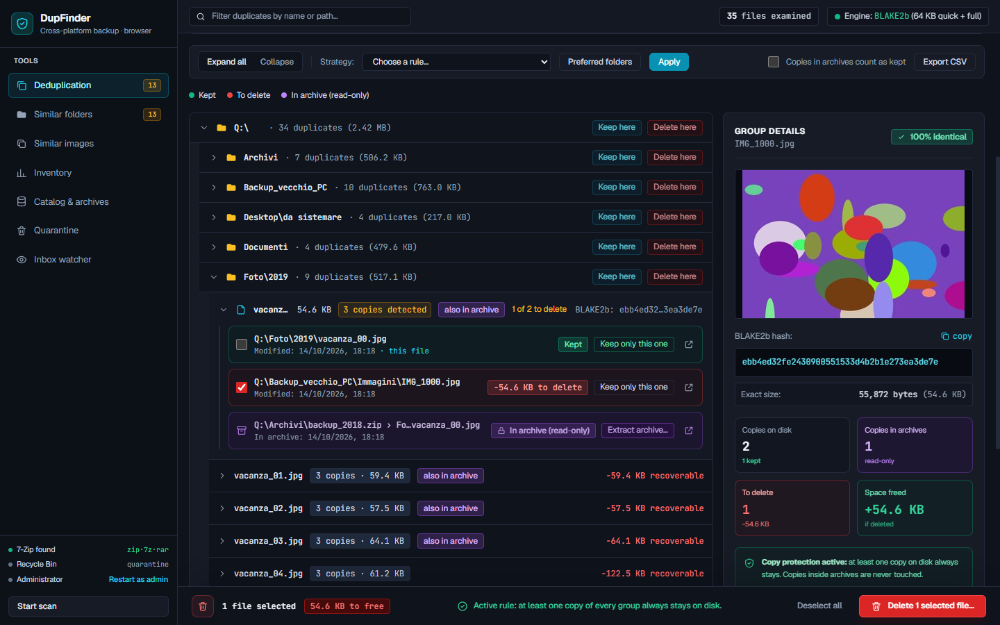

## Why

Years of "backup of the backup" leave the same photos and documents on several disks, in old PC folders,
on the desktop and inside zip files. DupFinder compares files by content, never by name, so
`IMG_1001.jpg` and `vacanza_01.jpg` are recognized as the same file.

## Modules

| Module | What it does |
|---|---|
| **Deduplication** | Duplicates by content (also inside archives), with safe deletion |
| **Similar folders** | Folders that are whole or partial copies of other folders: old backups that can go in one step |
| **Similar images** | Resized or recompressed copies of the same photo (perceptual hash) |
| **Inventory** | Space by file type, by year and by folder; the largest and the oldest files |
| **Catalog & archives** | Incremental local zips holding only files not archived yet, with a SQLite catalog: search, restore, integrity checks |
| **Quarantine** | Deleted files kept with their folder structure: restore them or delete them for good |
| **Inbox watcher** | Tells you whether the files dropped in a folder are already archived or already on disk |

## Features

- **Content-based matching** in three steps: size → quick hash (first and last 64 KB) → full BLAKE2b hash.
  Hashes are cached in a SQLite catalog, so later scans only read the files that changed.
- **Looks inside archives**: reads ZIP, 7z and RAR by streaming, without extracting them, up to 10 levels of nested
  archives (big Explorer zips with Deflate64 go through 7-Zip).
- **Extract archives to get rid of the copies they hold**: shows first how many files are already on disk and how much
  space is needed, skips the identical ones, never overwrites a file (name taken → " (1)"), and moves the archive to
  quarantine only if everything went fine. Not enough space, disk full, access denied, unsafe names inside the archive
  ("zip slip"), password-protected or damaged archives and cancellation are all handled without losing data.
- **Safe by design**:
  - every group always keeps at least one copy, checked by both the interface and the backend;
  - optionally, a copy inside an archive counts as kept, but only if the archive is still exactly the one scanned;
  - before deleting, DupFinder checks that the files have not changed since the scan;
  - the results and your selection are saved: they survive a restart.
- **Review tools**: folder tree, per-file list of copies with a preview, "Keep only this one", per-folder
  "Keep / Delete here", automatic rules (oldest, newest, shortest or longest path, "delete disk copies already in an
  archive"), **preferred folders** (e.g. always keep D:\Archive), a preview of what a rule will change, CSV export.
- **Three ways to delete**: system Recycle Bin, quarantine (`~/DupFinder_Quarantine/<date>/…`) or permanent.
- **Administrator mode** (Windows): "Restart as admin" relaunches DupFinder with UAC, keeping results and selection,
  to delete protected files. Read-only files are handled anyway.
- **External disks** are recognized by volume serial: an archive on a disk that moved from E: to F: is found again.
- **Fast**: multi-threaded folder walk and hashing per disk (parallel on SSDs, sequential on HDDs).
- **Skips what it should**: system folders, excluded names/patterns, cloud-only files (OneDrive/iCloud,
  so nothing gets downloaded), symlinks, junctions and hardlinks.

The interface is in English.

## Screenshots

**The desktop app**: a native window, no browser and no network port.

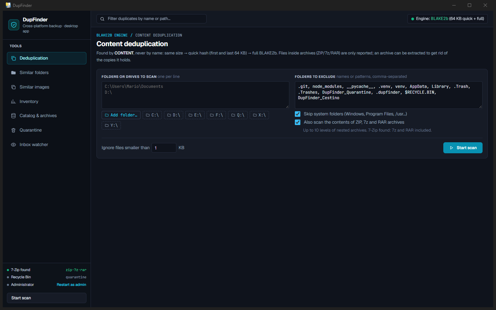

**Scan settings**: folders or whole drives (with a native folder picker in the app), exclusions, archives, minimum size.

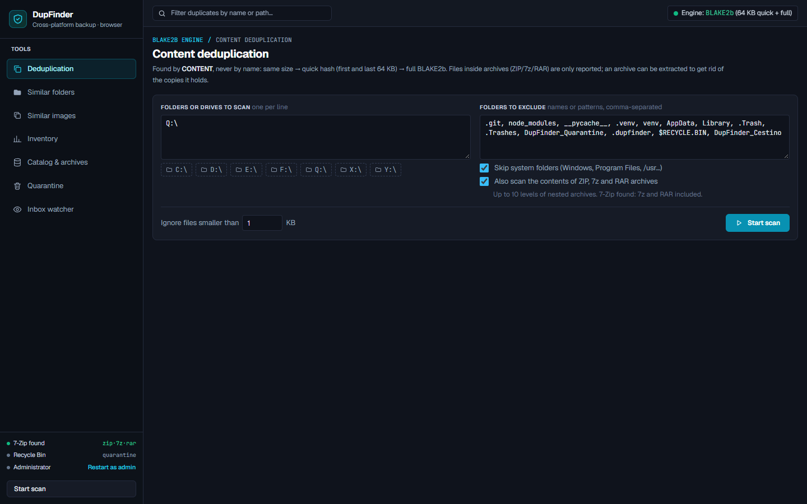

**Results**: files examined, duplicate groups, recoverable space, archive notices.

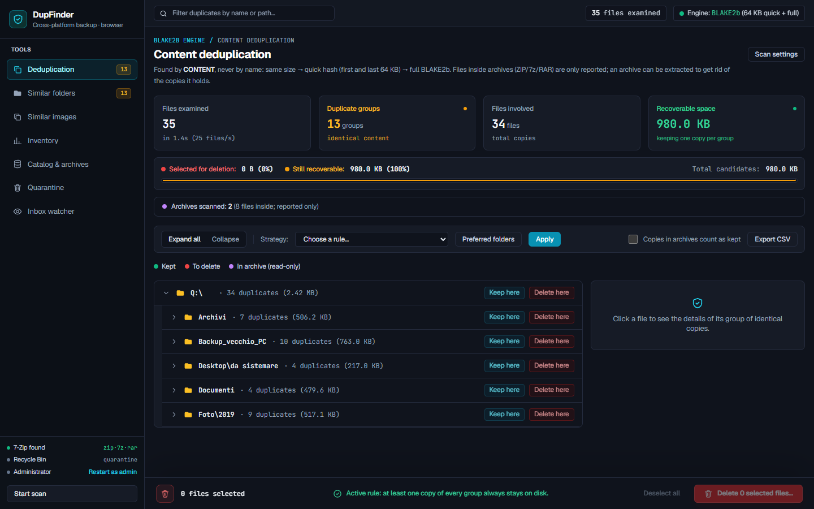

**Extract an archive**: what is already on disk, the space needed, what to do with the archive afterwards.

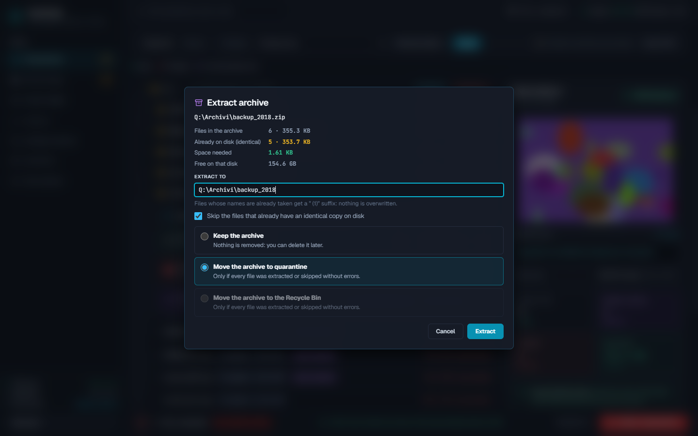

**Confirm the deletion**: Recycle Bin, quarantine or permanent.

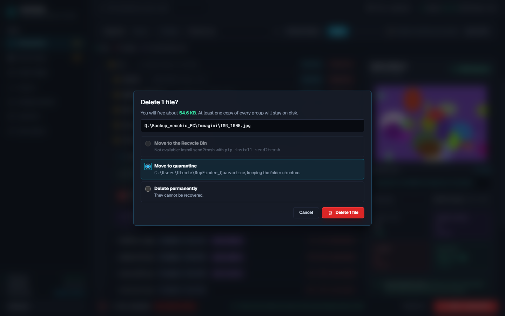

| | |
|---|---|
| **Similar folders** 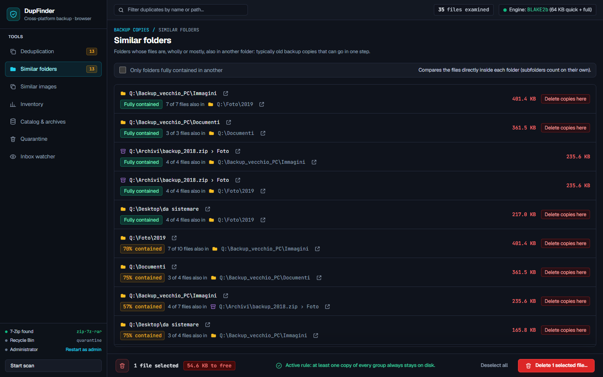 | **Similar images**  |
| **Inventory** 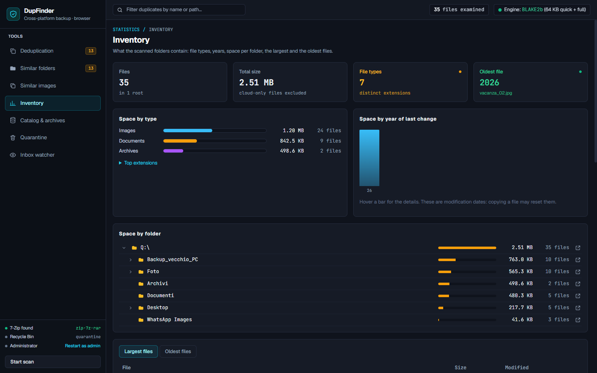 | **Catalog & archives** 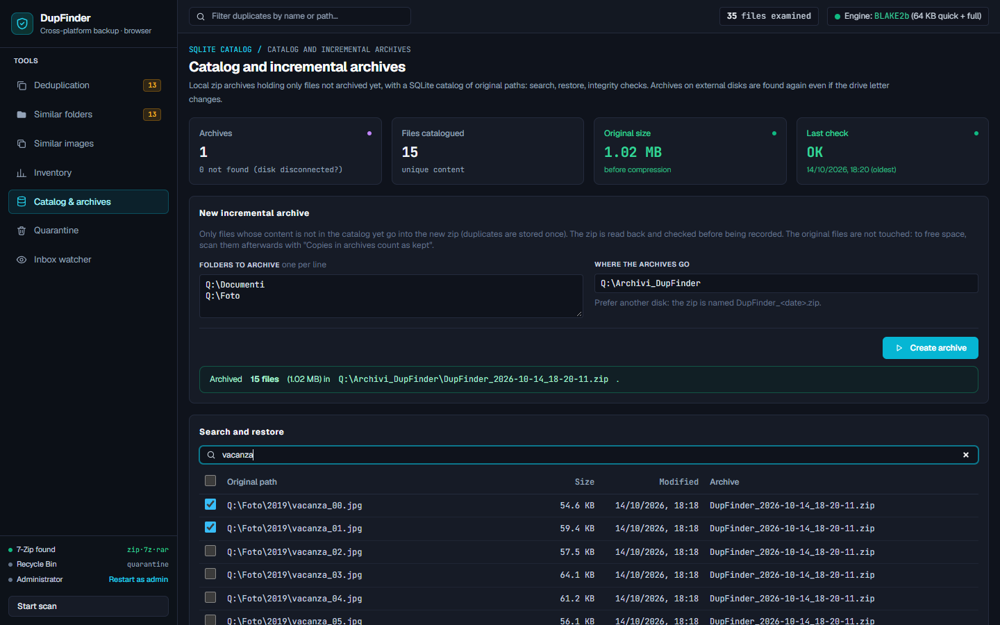 |
| **Quarantine** 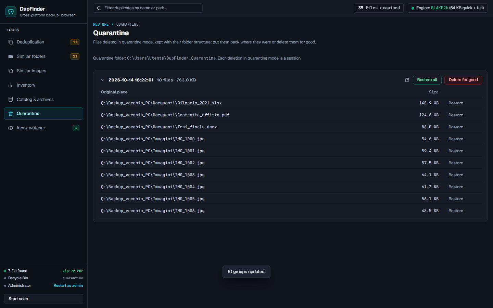 | **Inbox watcher** 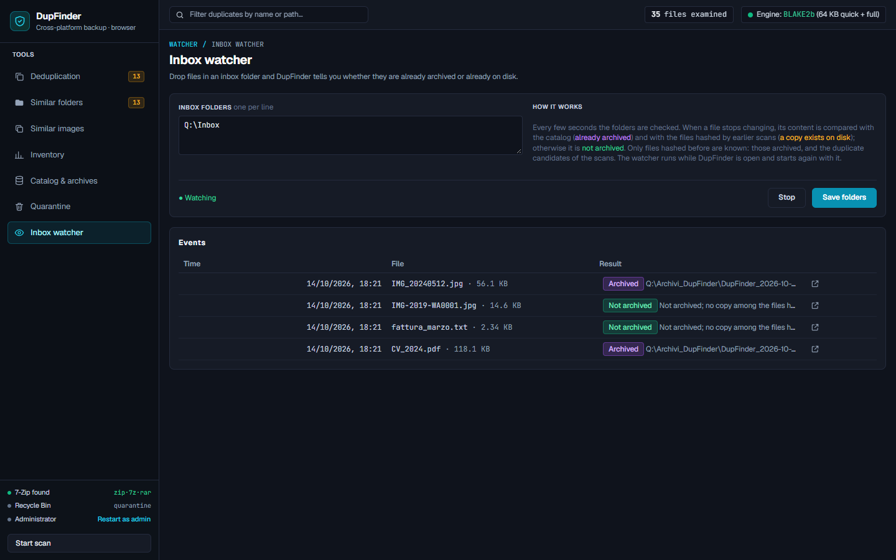 |

## Getting started

### As a desktop app (recommended)

Download `DupFinder-windows.zip` or `DupFinder-macos.zip` from the [Releases](../../releases) page. The builds are
not signed: on macOS right-click the app → Open the first time; on Windows SmartScreen may ask to confirm.
Releases are built by GitHub Actions (`.github/workflows/release.yml`) when a `v*` tag is pushed.

To build it yourself:

```bash
pip install pywebview Pillow send2trash pyinstaller
python build_app.py            # → dist/DupFinder.exe (Windows), DupFinder.app (macOS), DupFinder (Linux)
```

The result is a single executable: double-click it. Node.js is needed only to build it.

### From the sources

Requirements: **Python 3.8+**; Node.js to build the interface.

```bash
python start.py                    # builds the interface and opens DupFinder
python start.py D:\Photos E:\      # and starts a scan of these folders right away
python -m dupfinder --admin        # Windows: start as administrator
python -m dupfinder --browser      # use the browser instead of the desktop window
python -m dupfinder --help         # all options
```

With `pywebview` installed DupFinder opens its own window; without it, it opens in the browser
(served only on 127.0.0.1, with a random token). Optional extras:

- `pip install pywebview`: the desktop window (WebView2 on Windows, already part of Windows 10/11).
- `pip install Pillow`: similar images and image thumbnails.
- `pip install send2trash`: deletion to the system Recycle Bin (otherwise quarantine is the default).
- [7-Zip](https://www.7-zip.org/): needed to read and extract 7z and RAR archives. If it is installed in a
  non-standard location, set the `DUPFINDER_7ZIP` environment variable.
- `pip install -e .[all]`: installs the `dupfinder` command with all the extras.

Data lives in `~/.dupfinder` (catalog, saved session, settings) and `~/DupFinder_Quarantine`; both can be moved
with the `DUPFINDER_HOME` and `DUPFINDER_QUARANTINE` environment variables (e.g. for a portable copy).

## Development

```bash
python -m dupfinder --no-browser   # backend in browser mode on :8765
cd frontend && npm run dev         # interface with hot reload
python -m unittest                 # tests
```

- Backend: `dupfinder/` (Python standard library; pywebview, Pillow and send2trash are optional).
  `api.py` holds the API, used both by the HTTP server (browser mode) and by the pywebview bridge (desktop app).
- Frontend: `frontend/` (React 19 + Vite). `npm run build` writes to `dupfinder/web/`.

## Known limits

- RAR goes through the same 7-Zip path as 7z but has not been tested on real RAR files yet.
- The inbox watcher only knows the files hashed before (archived ones, and the duplicate candidates of the scans):
  a unique file on disk that was never hashed is not recognized as a copy.
- Similar folders compare the files directly inside each folder, not whole subtrees.
- Restarting as administrator is available on Windows only (on macOS/Linux start it with `sudo`).
- No protection against zip bombs.
